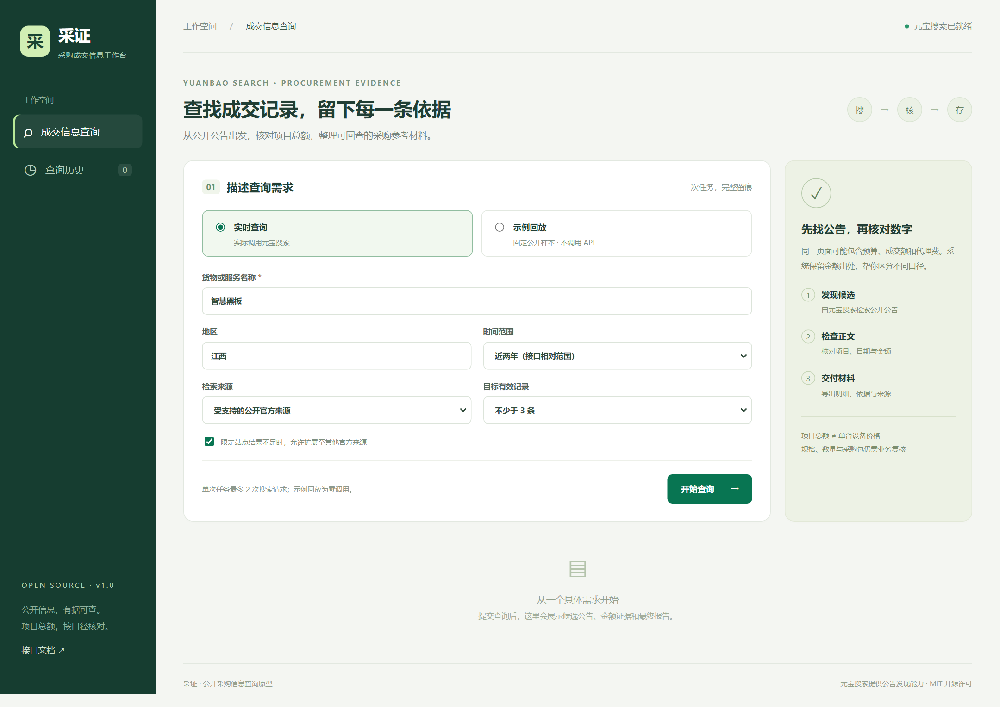

# 采证 · 采购成交信息工作台

基于元宝搜索的公开采购信息查询原型。输入货物和地区后，从候选公告中读取正文，区分项目成交总额与其他费用，保存来源依据，导出查询报告。

**MIT 许可 / FastAPI + 原生 HTML、CSS、JavaScript / SQLite / 支持本地与 Docker 部署**



## 能完成的任务

- 从前端提交实时查询，查看执行进度与日志。
- 真实调用元宝搜索服务 API KEY 接口，单任务最多两次搜索。
- 读取受支持的 HTTPS 官方来源，明确保留访问失败及不支持的附件状态。
- 在当前公告模板中核对正文元金额与概要万元金额；缺失、冲突、费率、多金额保持待复核。
- 按项目编号和总额识别重复线索；同编号不同金额不自动合并。
- 查看证据片段、原始链接、原公告日期、抓取时间和原文摘要哈希。
- 导出 HTML、带 UTF-8 BOM 的 CSV、JSON；HTML 报告可打印或另存 PDF。
- 保存任务历史，重启后仍可查看已有结果。
- 无密钥运行固定示例回放；页面清楚标注回放模式和样本日期。

金额核对通过不等于设备规格可比，也不等于最终采购结论。当前版本主要验证中国政府采购网常见总价公告模板；没有承诺所有地区、附件或费率报价均能自动处理。

## 1. 本地快速启动

需要 Python 3.12。前端无需 Node.js 或构建步骤。

```bash
python -m venv .venv
# Windows: .venv\Scripts\activate
# Linux/macOS: source .venv/bin/activate
pip install -r requirements.txt
python -m uvicorn app.main:app --host 127.0.0.1 --port 8000 --workers 1
```

打开 [http://127.0.0.1:8000](http://127.0.0.1:8000)。未配置密钥时默认提供示例回放，可先完成一次查询和导出。

Windows 也可在项目目录运行：

```powershell
pwsh -File .\run.ps1
```

首次安装依赖需要联网。`run.ps1` 创建项目内虚拟环境，未写入全局配置。

## 2. 配置真实查询

配置元宝搜索**服务 API KEY**，不是单独的腾讯云 SecretId：

```powershell
# PowerShell 当前终端
$env:YUANBAO_API_KEY = "你的服务APIKEY"
python -m uvicorn app.main:app --host 127.0.0.1 --port 8000 --workers 1
```

```bash
# Linux/macOS 当前终端
export YUANBAO_API_KEY='你的服务APIKEY'
python -m uvicorn app.main:app --host 127.0.0.1 --port 8000 --workers 1
```

也兼容现有 `yuanbao_search` 变量；在 Windows 本地启动时可读取用户级已保存变量。服务端不会把密钥发送给前端或写入任务报告。

本地 Python 启动不会自动加载 `.env`；请使用上述环境变量方式。`.env.example` 供 Docker Compose 读取，复制后自行填写，不提交 `.env`。

| 变量 | 默认 | 说明 |
| --- | --- | --- |
| `YUANBAO_API_KEY` | 空 | 元宝搜索服务密钥，优先使用 |
| `yuanbao_search` | 空 | 兼容本项目原有命名 |
| `DATA_DIR` | `./data` | SQLite 与本地原文快照目录 |
| `USE_ENV_PROXY` | `true` | 是否遵循 HTTP_PROXY / HTTPS_PROXY |
| `APP_ACCESS_TOKEN` | 空 | 可选工作台访问口令，非本机访问时建议设置 |

若环境代理失效，可在确认需要直连时设置 `USE_ENV_PROXY=false`。系统不会降低 TLS 校验等级；遇到原站 TLS 错误会保留原因。

## 3. Docker Compose 部署

需要可用的 Docker Engine 和 Compose：

```bash
cp .env.example .env
# 编辑 .env，填写 YUANBAO_API_KEY；也可先留空体验回放
docker compose up -d --build
docker compose ps
```

Windows 复制命令：`Copy-Item .env.example .env`。

访问 [http://127.0.0.1:8000](http://127.0.0.1:8000)。数据保存在 `procurement-data` 命名卷，容器内为 `/data`。默认使用非 root 用户运行，宿主机端口绑定回环地址。

云服务器可通过 SSH 端口转发访问，或者在宿主机配置 HTTPS 反向代理。对外提供服务前设置 `APP_ACCESS_TOKEN`；如要更改端口绑定，请同时配置访问控制。该版本为单实例原型，保持 `--workers 1`，不提供多用户隔离或分布式任务队列。

```bash
docker compose logs --tail=100 workbench
docker compose down       # 不删除命名卷
```

本轮本地验证情况见 [验证说明](docs/VALIDATION.md)。提供 Dockerfile 与 Compose 不代表已经在当前主机完成镜像构建。

## 4. 完成一次任务

1. 选择“实时查询”，填写“智慧黑板 / 江西 / 近两年 / 目标不少于 3 条”。
2. 点击“开始查询”，查看联网检索、候选整理和原文核对进度。
3. 切换结果状态，查看“金额核对通过”和“待复核”的具体原因。
4. 点击“查看依据”，对照正文金额、概要换算、来源及时间。
5. 点击“查看报告”或导出 HTML、CSV、JSON。
6. 在“查询历史”重新打开任务并再次导出。

实时模式每次创建任务可能消耗元宝搜索额度；只有指定站点结果不足且勾选扩展时，才会进行第二次搜索。

示例回放固定使用“智慧黑板 / 江西 / 全部来源”，读取 2026-10-30 的十条候选和四份最小正文摘录，预期四条金额核对通过。将目标改为五条可查看“记录不足”状态。未收录正文保持待复核，不会伪装成实时访问失败或补造数据。

## 5. 项目结构

```text
app/
  main.py       HTTP 接口、生命周期与访问口令
  models.py     查询输入校验
  service.py    任务流程、进度、重复线索处理
  provider.py   元宝搜索、受限来源读取及回放
  parser.py     金额、日期、公告类型规则
  store.py      SQLite 任务持久化
  exporter.py   HTML / CSV / JSON 报告
static/         前端页面、样式与交互
fixtures/       已脱敏的固定回放数据
tests/          不依赖真实 API 的测试
docs/           架构、验证与使用说明
Dockerfile      容器镜像配置
compose.yaml    单实例部署配置
```

详见 [架构说明](docs/ARCHITECTURE.md)、[接口说明](docs/API.md)。

## 6. 测试

```bash
pip install -r requirements.txt pytest==9.1.1
python -m pytest -q
```

测试覆盖金额截断、单位换算、代理费混淆、公告类别、金额冲突、重复记录、URL 限制、回放完整流程、导出、持久化及访问口令。提供 [GitHub Actions 示例](docs/ci/github-actions.yml.example)，需要时复制到 `.github/workflows/tests.yml` 启用 Python 3.12 测试流程；当前仓库未启用自动工作流。

## 7. 开源与贡献

本地源码已附 MIT 许可，可复制、修改、部署和分发。公开网页和第三方服务仍保留各自权益，见 [第三方材料说明](THIRD_PARTY_NOTICES.md)。

运行数据、原文快照、密钥与 `.env` 被排除在仓库与源码包之外。提交问题时提供脱敏的查询条件和请求标识即可。

改进方向包括：更多公告模板、包件拆分、更正关系、经确认的单价明细，以及单独的工作进程。不能用更多工具替代事实核验。

官方参考：[API KEY 接入](https://cloud.tencent.com/document/product/1806/130615)、[SearchPro](https://cloud.tencent.com/document/product/1806/121811)。
