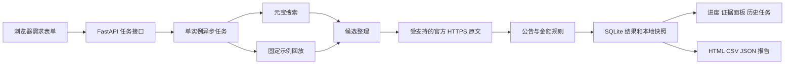

# 架构与处理边界

## 数据与状态

任务状态为 queued、running、completed、partial、failed、interrupted。有效记录达到目标为 completed；正常结束但数量不足为 partial。未完成任务在服务重启后改为 interrupted，不伪装成完成。

记录状态为 verified、pending、excluded、duplicate。`verified` 仅表示本版规则定位到总价成交口径，并提取项目编号和日期，概要与正文金额一致。它不表示完成设备规格、数量、附件和更正关系的全部业务复核。

`amount_yuan` 保存十进制字符串，不用二进制浮点做金额计算。`published_date` 来自正文，`search_date` 来自搜索结果，`fetched_at` 是本次读取时间，三者分别保存。

## 查询和读取上限

一次任务先执行一次搜索；指定站点且有效记录不足、用户勾选扩展时，最多再执行一次。每次最多处理二十条返回页面，原文并发为三，每页上限 2 MB，读取超时十八秒。未以自动循环重试方式消耗额度。

原文只接受受支持的 HTTPS 官方来源及其子域，禁止用户信息、异常端口、IP 地址及任意域名。每次重定向重新验证目标，不关闭证书验证。对于非文本附件和无法访问的页面，保留待复核原因。

标题预筛会保留更正及澄清关联线索，不直接计为成交结果。已核验记录同编号同总额的后续来源标记为重复；同编号不同金额全部改为待复核。本版未实现完整公告版本关系和包件拆分。

## 存储与部署

SQLite 每次保存完整任务 JSON，参数化 SQL 查询。原文快照写入 DATA_DIR/snapshots，应用不会把该目录作为静态目录公开。HTML/CSV/JSON 报告只包含结构化结果和必要证据。

当前版本运行一个 Uvicorn worker，任务在进程内执行。关闭服务会中断正在执行的任务，但已保存的历史结果仍可查看。需要生产级并发、多人隔离或任务恢复时，应另加鉴权、队列、独立 worker 和备份策略。

## 前端

前端不包含服务密钥，不请求元宝搜索域名。创建任务后通过本服务轮询进度，使用 textContent 渲染来源标题和证据，避免直接把外部文本当 HTML 插入。导出通过浏览器下载得到本地文件。
